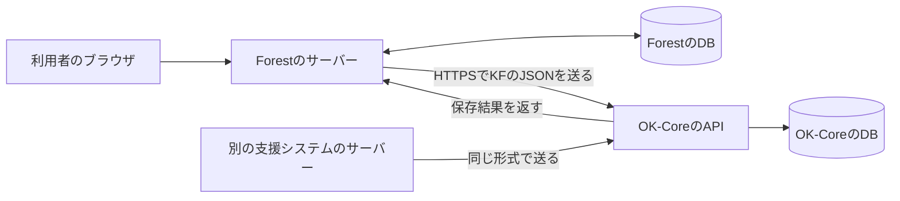
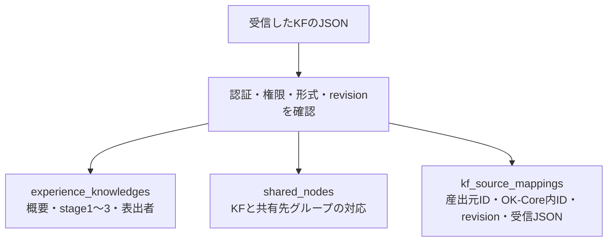
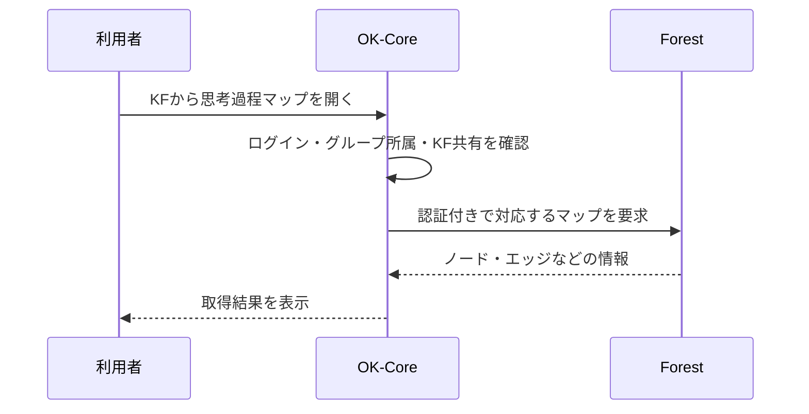

# OK-Core共通APIの読み方と現在の仕組み

情報系の初学者向け／2026-10-30・段階1～2の実装に対応

## この文書の使い方

この文書は、プログラミングの基礎を学び始めた学生が、OK-Coreの共通API仕様を読めるようになるための説明です。APIを使った開発経験は前提にしません。

まず1～6章で通信とデータを理解し、7～9章で仕様ファイルの読み方を確認してください。10章以降は、実装・DB・エラーを調べるときの説明です。文中のID・利用者・トークンは説明用です。

実際の項目名・文字数制限を調べる場合は、次を参照します。

- [OpenAPI仕様](../api/v1/openapi.yaml)：窓口・送信方法・認証・応答の一覧
- [JSON Schema](../api/v1/schemas/kf-put.schema.json)：送信JSONが守る形と制限
- [送信JSONの例](../api/v1/examples/kf-put.json)：項目に値を入れたサンプル
- [開発・配備用の接続ガイド](../api/v1/README.md)：設定方法や実装上の規則

本書の説明・通信例を読むだけでDBが変わることはありません。新しいテーブルやカラムを追加する手順も含みません。

## 1. 共通APIが解決すること

Forest-platformには、思考整理の記録と、そこから本人が得たKFがあります。別の支援システムには、議論の発言と、そこから得たKFがあります。内部の記録形式はシステムごとに異なります。

そこで、各システムが共有する情報を決めた形式へ変換し、OK-Coreへ送ります。この受け渡しの窓口が**共通API**です。



ForestはForestのDBへ保存し、OK-CoreはOK-CoreのDBへ保存します。ForestからOK-Coreのテーブルを直接INSERTすることは、共通APIの利用方法に含みません。

この分担により、産出元のDB構造を変えたときは、主に産出元の「共通JSONへの変換処理」を直せばよくなります。接続相手へ知らせる情報と約束を保つことが、独立した接続の基本です。

### 最初に押さえる用語

| 用語 | この仕組みでの意味 |
| --- | --- |
| API | プログラムが他のプログラムへ依頼する窓口。画面上のボタン自体を指す言葉ではありません |
| サーバー | 利用者や他システムからの依頼を受けて処理するプログラム側 |
| リクエスト | 「このKFを保存してほしい」など、送る依頼 |
| レスポンス | 「保存できた」「権限がない」など、依頼への返答 |
| HTTP／HTTPS | リクエストとレスポンスをやり取りする通信の仕組み。HTTPSでは通信を暗号化します |
| JSON | 項目名と値を組み合わせて、データを文字で表す形式 |
| エンドポイント | APIの個別の窓口。HTTPメソッドとURLを組み合わせて特定します |
| 正本 | データを作成・更新する責任を持つ原本。産出したKFの正本は産出側にあります |
| スナップショット | ある時点の内容のコピー。送った時点のKFや形成文脈を確認するために使います |

## 2. 1回の通信を4つに分けて読む

APIへの依頼は、次の4つに分けると理解できます。

| 部分 | 見る内容 | KF登録の例 |
| --- | --- | --- |
| HTTPメソッド | 何をしたいか | `PUT`：指定したKFを登録・更新する |
| URL | どの窓口・どのデータか | Forestが産出したKF `7` |
| ヘッダー | 認証やデータ形式などの付属情報 | システム用トークン、操作中の人の識別子 |
| ボディ | 依頼するデータ本体 | KFの概要・stage・形成文脈などのJSON |

説明用のリクエストは次の形です。`example.invalid`は説明用の接続先であり、実際のサーバーではありません。

```http
PUT https://example.invalid/software/OK-Core/api/v1/source-systems/forest-platform/knowledge-fragments/7
Authorization: Bearer <システム用トークン>
X-Acting-User-Sub: example-sso-sub
Content-Type: application/json
X-Request-Id: forest-demo-001

{ここにKFのJSONが入る}
```

ヘッダーとボディの間には空行があります。`Content-Type: application/json`は「ボディをJSONとして送っている」という指定です。

この通信は通常、**ForestのサーバーからOK-Coreのサーバーへ**行います。ブラウザにはシステム用トークンを渡しません。

### URLの分解

```text
https://example.invalid/software/OK-Core/api/v1
└ 接続先の基点URL

/source-systems/forest-platform/knowledge-fragments/7
└ 個別の窓口と対象データ
```

仕様書では、基点URLより後の部分を次のように書いています。

```text
/source-systems/{system_code}/knowledge-fragments/{external_kf_id}
```

`{...}`は、実際の値に置き換える場所です。波括弧ごと送るわけではありません。

- `{system_code}` → `forest-platform`
- `{external_kf_id}` → `7`

## 3. 現在のAPI一覧

次の表はOK-Coreが提供する窓口です。URLは基点URL `/api/v1` から後の部分です。段階2で追加した産出側の文脈GETは、14章で別に説明します。

| メソッドとURL | 依頼の内容 | 認証 |
| --- | --- | --- |
| `GET /health` | OK-CoreがDBへ接続できるか確認する | 不要 |
| `GET /capabilities` | 対応する形式・文字数・機能を確認する | 不要 |
| `GET /users/me/knowledge-groups` | 操作中の人が所属する有効なグループを取得する | 必要 |
| `PUT /source-systems/{system_code}/knowledge-fragments/{external_kf_id}` | KFを登録・更新する | 必要 |
| 上と同じURLへの`DELETE` | 産出元でKFを削除したことを通知する | 必要 |

`GET`は取得、`PUT`は対象を指定した登録・更新、`DELETE`は削除通知に使います。URLが同じでもメソッドが違えば依頼の意味が変わります。

`health`が成功しても、必要なテーブルがすべて揃ったことや、KFを実際に共有できることまでは保証しません。`capabilities`も、対応仕様の確認用です。

## 4. JSONの記号と「入れ子」を読む

```json
{
  "summary": "具体例を選ぶ前に、伝えたい目的を確認する",
  "source_revision": 1,
  "activity": {
    "type_code": "thinking_process_map",
    "external_activity_id": "map-42"
  },
  "share_group_ids": ["1", "2"]
}
```

| 記号・書き方 | 意味 |
| --- | --- |
| `{ ... }` | オブジェクト。項目名と値をまとめたもの |
| `"summary": "..."` | `summary`という項目に文字列の値が入る |
| `[ ... ]` | 配列。複数の値を並べたもの |
| `"1"` | 文字列の1 |
| `1` | 数値の1 |
| `true` / `false` | 真偽値。文字列ではないので引用符を付けない |
| `null` | 値がないことを表す値。項目を省略することとは区別する |

`activity`の中にさらにオブジェクトが入っています。このように構造を中へ重ねることを「入れ子」と呼びます。

説明文で`activity.type_code`と書く場合は、「activityの中のtype_code」という意味です。JSONの項目名そのものにピリオドが含まれるという意味ではありません。

配列の位置は0から数えます。たとえば`stages[0].stage_code`は、「stages配列の最初の要素にあるstage_code」です。

JSONでは、項目の区切りにカンマを使います。最後の要素の後にカンマを付けず、コメントも書き込みません。説明用に一部を省略した例は、そのまま送信できる完全なKFではありません。

## 5. KFを登録するJSON全体

以下は、共通仕様を満たす説明用の例です。表出者とグループが実DBに登録されていることは意味しません。

```json
{
  "protocol": {
    "code": "OK_CORE_KF",
    "version": "1.0"
  },
  "source_revision": 1,
  "source_updated_at": "2026-10-30T10:00:00+09:00",
  "expresser_sso_sub": "example-sso-sub",
  "summary": "具体例を選ぶ前に、伝えたい目的を確認する",
  "activity": {
    "type_code": "thinking_process_map",
    "external_activity_id": "map-42"
  },
  "context_package": {
    "external_context_package_id": "9",
    "items": [
      {
        "entity_type_code": "process_node",
        "entity_id": "node-7",
        "display_order": 0,
        "snapshot": {
          "content": "研究目的を再検討した"
        }
      }
    ]
  },
  "stages": [
    {
      "stage_code": "stage1",
      "rendered_content": "発表で示す具体例を選んでいた",
      "slots": [
        {
          "slot_code": "situation",
          "value": "研究発表の準備"
        }
      ]
    },
    {
      "stage_code": "stage2",
      "rendered_content": "その例で何を伝えたいかを考え直した",
      "slots": []
    },
    {
      "stage_code": "stage3",
      "rendered_content": "目的に合う例を選ぶ必要があると気づいた",
      "slots": []
    }
  ],
  "share_group_ids": ["1"]
}
```

### 上から順に読む

| 項目 | 意味 | この例の内容 |
| --- | --- | --- |
| `protocol` | KFデータの形式の名前と版 | OK_CORE_KFの1.0形式 |
| `source_revision` | そのKFの更新版 | 第1版 |
| `source_updated_at` | 産出側で更新した日時 | 日本時間の2026年10月30日10時 |
| `expresser_sso_sub` | KFを表出した人のSSO識別子 | example-sso-sub |
| `summary` | KFの概要 | 得られた知の要約 |
| `activity` | KFが生まれた活動 | 思考過程マップmap-42 |
| `context_package` | KFの背景となる記録のまとまり | 文脈パッケージ9に含まれる記録 |
| `stages` | KFの内容を段階別に記述した配列 | stage1～3の記述 |
| `share_group_ids` | 共有を依頼するOK-CoreのグループID | グループ1 |

`+09:00`はUTCから9時間進んだ時刻を表します。時刻だけでなくタイムゾーンを付けることで、サーバーの地域が違っても同じ時点を表せます。

### stageとslotの違い

`stage`は記述のまとまり、`slot`はその中の細かい項目です。

```text
stages
 ├ stage1
 │  ├ rendered_content：まとまり全体の文章
 │  └ slots
 │     └ situation：場面を個別に記した値
 ├ stage2
 └ stage3
```

この例では「状況・考え直したこと・気づき」の順に文章を配置しました。この意味づけをAPIの番号だけから自動的に決めているわけではありません。現在の受信処理が確認するstage_codeは`stage1`・`stage2`・`stage3`で、slot_codeは産出側が定義します。

現在は`stages`という配列自体が必須で、空配列や一部stageだけでも受理します。同じstage_codeを重ねたり、同じstage内でslot_codeを重ねたりするとエラーになります。

### activityとcontext_packageの違い

`activity`は「どの活動か」、`context_package`は「そのKFの背景として、どの記録を残したか」を表します。

思考過程マップ全体を活動として指し、その中の特定のノードを形成文脈として指す、という関係です。

| 文脈内の項目 | 意味 |
| --- | --- |
| `external_context_package_id` | 産出側にある文脈のまとまりのID |
| `items` | 背景として残す記録の配列 |
| `entity_type_code` | 記録の種類。この例はprocess_node |
| `entity_id` | その種類の中での記録ID。この例はnode-7 |
| `display_order` | 表示する順序を示す0以上の整数 |
| `snapshot` | 記録の内容をコピーしたもの。この例はcontentという文章 |

snapshotの中の項目は活動ごとに異なって構いません。思考整理ならノード内容、議論なら発言内容や話者などが考えられます。OK-Coreは`entity_type_code`を見て相手のDBテーブルへ直接接続する処理を行いません。

## 6. IDを混同しないための対応表

「ID」という名前でも、識別している対象が異なります。

| 名前 | 識別する対象・管理する側 | 例 |
| --- | --- | --- |
| `system_code` | 産出システム。OK-Coreの接続設定に登録 | forest-platform |
| `external_kf_id` | 産出側のKF | 7 |
| 応答の`knowledge_fragment_id` | OK-Coreに保存したKF | 5017 |
| `expresser_sso_sub` | 共通SSOで識別する人 | example-sso-sub |
| 各DBの`user_id` | そのDB内で識別するユーザー | 同じ人でもシステムごとに異なる場合がある |
| `external_activity_id` | 産出側の活動 | map-42 |
| `external_context_package_id` | 産出側の形成文脈のまとまり | 9 |
| `entity_id` | 産出側の特定の記録 | node-7 |
| `share_group_ids`の各値 | OK-Coreの共有先グループ | 1 |
| `request_id` | 今回の通信・処理を追跡する番号 | forest-demo-001 |

特に大切なのは、**KFの対応を「産出システム＋産出側のKF ID」で決めること**です。

```text
forest-platform の KF 7       → OK-Core の KF 5017
discussion-kf-system の KF 7  → OK-Core の別のKF
```

産出元が違えば同じ7でも別KFです。産出側の7とOK-Core側の5017が違っていても、異常ではありません。

外部KF IDには`knowledge_fragment_7`などの文字列も使えます。JavaScriptが正確に表せない大きな整数をIDとして扱うときも、文字列で送ります。現在のDBの照合順序によって大文字小文字などが衝突した場合は、別IDを上書きせずエラーにします。

`request_id`はKFのIDではありません。同じKFを何度か送信する場合、通信の追跡IDとKFの識別子は分けて扱います。

## 7. OpenAPI仕様ファイルの読み方

OpenAPIは、APIの窓口や使い方を一定の形式で記述するための仕様です。今回の`openapi.yaml`はJSON記法で書かれています。拡張子が`.yaml`でも、YAML 1.2として読める記法なので、先頭が`{`で始まっていて問題ありません。

### ファイルの大きな構造

```text
openapi.yaml
 ├ openapi       このファイルが従うOpenAPIの版
 ├ info          APIの名前・仕様書の改訂番号・説明
 ├ servers       基点URL
 ├ paths         個別の窓口
 │  └ /source-systems/{system_code}/knowledge-fragments/{external_kf_id}
 │     ├ parameters  URLに埋める値
 │     ├ put         登録・更新の仕様
 │     └ delete      削除通知の仕様
 └ components    共通して使う定義
    ├ securitySchemes  認証方法
    └ schemas         応答やエラーなどのデータ構造
```

### 各見出しの意味

| 項目 | 読み方 |
| --- | --- |
| `openapi` | 今回は3.1.0。APIを説明するファイル形式の版 |
| `info.title` | APIの名前 |
| `info.version` | 今回は1.2.0。仕様書の改訂番号 |
| `servers[].url` | リクエスト先の基点URL。実環境に合わせて指定する |
| `paths` | 個別のURL一覧 |
| `get` / `put` / `delete` | そのURLで使えるHTTPメソッド |
| `operationId` | その操作に付けた識別名。追加で送信するJSON項目ではない |
| `summary` / `description` | 操作の短い説明・詳しい説明 |
| `parameters` | URLやヘッダーに入れる値 |
| `requestBody` | 送信するボディの定義 |
| `responses` | HTTPステータスごとの応答の定義 |
| `components` | 複数箇所で再利用する定義の置き場 |

APIを使うときは、まず`paths`から行いたい操作を探し、`parameters`、`requestBody`、`responses`の順に読みます。

段階2で追加した文脈GETは、各操作の`servers`に産出元のURLを指定しています。ファイル先頭の基点URLを使うOK-Coreの窓口と、操作ごとに接続先を指定する産出側の窓口を区別します。

### parametersを読む

```json
{
  "name": "system_code",
  "in": "path",
  "required": true,
  "schema": {
    "type": "string"
  }
}
```

これは「system_codeという文字列を、URLの埋め込み部分に必ず指定する」という意味です。

- `in: "path"`：URLの`{...}`へ入れる
- `in: "header"`：HTTPヘッダーへ入れる
- `required: true`：そのパラメーターを省略できない

`requestBody.required: true`の場合は、ボディ自体が必要という意味です。ボディ内の各項目が必須かどうかはJSON Schemaの`required`を確認します。

### $refを読む

```json
{
  "$ref": "./schemas/kf-put.schema.json"
}
```

`$ref`は「詳しい定義を別の場所から参照する」という意味です。この例は、PUTボディの形を別ファイルで定義しています。

`#/components/schemas/Error`なら、同じOpenAPIファイル内の`components → schemas → Error`を参照します。`#`は同じファイル内を指します。

### securityを読む

```json
{
  "security": [
    {"SourceBearer": []}
  ]
}
```

これは、`SourceBearer`として定義したBearer認証が必要という指定です。内側の`[]`は、このHTTP Bearer方式ではOAuthのscope名をここに列挙しないという形であり、認証不要の指定ではありません。アプリ独自の操作権限は設定とPHPで確認します。

操作の`security: []`は、認証を要求しない指定です。現在のhealthとcapabilitiesに使っています。

### 版番号を分けて読む

| 番号 | 今回の値 | 何の版か |
| --- | --- | --- |
| `openapi` | 3.1.0 | 仕様書の書式 |
| `info.version` | 1.2.0 | このAPI仕様書の改訂 |
| URLの`/api/v1` | v1 | APIの互換性を分ける窓口 |
| JSONの`protocol.version` | 1.0 | KFデータの形式 |
| JSONの`source_revision` | 1、2、3… | 個々のKFの更新版 |

仕様書の改訂番号が1.2.0になっていても、送信するprotocol.versionを1.2.0へ変えるという意味ではありません。

## 8. JSON Schemaの読み方

JSON Schemaは、JSONデータが守る形や制限を記述したものです。この文脈の「schema」はJSONの構造を指します。DBのテーブル構造を指す「DBスキーマ」とは対象が異なります。

次は説明用の抜粋です。実際のKFには、このほかの必須項目もあります。

```json
{
  "type": "object",
  "properties": {
    "summary": {
      "type": "string",
      "minLength": 1,
      "maxLength": 255
    }
  },
  "required": ["summary"]
}
```

上から「オブジェクトを送り、その中にsummaryという文字列を入れる。長さは1～255文字。summaryは省略できない」と読みます。

| キーワード | 意味 |
| --- | --- |
| `$schema` | JSON Schemaのどの版を使うか。今回は2020-12 |
| `$id` | スキーマ自体を識別する名前。KFのIDや接続先URLではない |
| `type` | 値の種類。object、array、string、integerなど |
| `properties` | オブジェクトの各項目の定義 |
| `required` | そのオブジェクト内で省略できない項目名の配列 |
| `items` | 配列の各要素が守る定義 |
| `enum` | 列挙した値のどれかを選ぶ |
| `const` | この1つの値に固定する |
| `minLength` / `maxLength` | 文字列の長さの下限・上限 |
| `minimum` / `maximum` | 数値の下限・上限 |
| `pattern` | 文字列の書き方を制限する正規表現 |
| `format: "date-time"` | 日時形式を表す指定 |
| `oneOf` | 並べた定義のうち、ちょうど1つに当てはまる |
| `additionalProperties: true` | 定義済み以外の追加項目も許す |

たとえばグループIDには、数値`1`と文字列`"1"`の両方を受け付ける定義があります。`oneOf`で、このような複数の表現を記述しています。

`properties`に書かれているだけでは必須になりません。`required`も確認します。また、requiredは「その項目があること」を要求するもので、配列が空でもよいか、文字列が空でもよいかは別の制限で決まります。

`additionalProperties: true`でも、追加項目に自動的に新しい機能が生まれるわけではありません。たとえばJSONへ`share_policy`を足しても、管理者が設定した共有方式を変更できません。

### 仕様ファイルと実行プログラムの役割

```text
OpenAPI              APIの使い方を記述する
JSON Schema          送信JSONの形を記述する
contract.php         現在のサーバーで入力を検証する
service.php          認証・処理の振り分け・DB保存・応答を行う
```

現在のサーバーは、PHPの検証関数を実行しています。JSON Schemaファイルを毎回読み込んで自動検証する実装ではありません。仕様とPHPの両方を揃え、テストで差を確認します。

JSON Schemaだけでは表しにくい規則もあります。たとえば「同じstage内でslot_codeを重複させない」「本当にそのグループに所属しているか」は、PHPの検証やDB照会で確認します。JSON Schemaの検証を通ることと、登録権限があることは別です。

## 9. capabilitiesの応答を読む

`GET /capabilities`は、現在対応する仕様をプログラムから確認する窓口です。次は応答の一部を抜き出した例です。

```json
{
  "data": {
    "max_payload_bytes": 1048576,
    "external_id_type": "string",
    "storage": {
      "adapter": "legacy_experience",
      "slots": "payload_snapshot",
      "normalized_stages_and_slots": false
    },
    "context": {
      "snapshot": "context_package.items",
      "generic_live_context_proxy": true
    }
  },
  "meta": {
    "request_id": "ok-core-demo-001"
  }
}
```

- 最大ボディは1,048,576バイト（1 MiB）です。文字数制限とは別に、全体の容量も確認します。
- 外部KF IDは文字列として扱えます。
- 現在の保存先は既存のexperience系テーブルです。
- slotは受信JSONのコピーに保存し、slot専用テーブルには分けていません。
- 共通の文脈スナップショットは扱えます。登録した産出元の文脈を取得する共通窓口を、段階2で追加しました。

このほか、対応プロトコル・stage・文字数・再送規則・共有方式も返します。システム用トークンや、登録されているシステム一覧は返しません。

## 10. リクエストを受け取った後の現在の処理

### Forest側のコードにある処理

1. 利用者がKFを保存・共有する操作を行う。
2. Forestが自分のDBへKFと形成文脈を保存する。
3. 同じ保存処理の中で、Outboxへ送信予定のJSONを記録する。
4. これらをコミットしてから、OK-CoreへHTTP送信する。
5. 成功・失敗をOutboxへ記録する。

**Outbox**は、送信予定・送信結果を保存する領域です。送信先が停止していてもKF正本と送信予定を残し、後で再送するために使います。再送スクリプトがあることと、AWSで定期実行されていることは別に確認します。

### OK-Core側の処理

1. URLとメソッドから操作を決める。
2. トークンから呼出元システムを確認し、操作権限を調べる。
3. SSOのsubに対応する有効なユーザーを確認する。
4. JSONの構造・文字数・プロトコル、共有先への所属を確認する。
5. 産出元IDから、OK-Core内のKFと受理済みrevisionを調べる。
6. 新しい版なら、KF・共有・対応情報をまとめて保存する。同版の同じ内容なら重複成功を返す。
7. 結果とrequest_idをJSONで返す。

複数の保存を「全部成功」または「全部取り消し」にまとめる仕組みを**トランザクション**と呼びます。コミットは確定、ロールバックは確定前の変更の取り消しです。

ForestのDB保存とOK-CoreのDB保存は、それぞれのシステム内でまとめます。ネットワークの向こう側も含めた1つのDBトランザクションにはしていません。通信失敗をOutboxと再送で扱います。

### 現在の保存先



| 保存先 | 役割 |
| --- | --- |
| `experience_knowledges` | 表示に使うKF概要、stage本文、ユーザー等 |
| `shared_nodes` | `fragment_source_type`、KF ID、グループIDによる共有情報 |
| `kf_source_mappings` | どのシステムのどのKFか、OK-Core内ID、版、削除情報、受信JSONのコピー |

文脈・slotを含むJSON全体のコピーは`kf_source_mappings.snapshot_json`に保存します。指定ER図にある`knowledge_fragments`やstage/slot専用表への移行は段階3で予定しています。

段階1の共通APIで別システムのKFを受け取っても、現在の保存アダプターはexperience系です。産出元の識別は保持しますが、discussion専用の保存・表示へ自動的に振り分ける機能までは含みません。

## 11. 認証と権限を3つに分ける

### ① どのシステムからの通信か

`Authorization: Bearer ...`のトークンで確認します。トークンは各システムで別の値にし、OK-Coreの非公開設定へ登録します。

Forest用のトークンで、URLだけ別システムのsystem_codeへ変えた要求は拒否します。system_codeという文字を送るだけで、そのシステムとして認められるわけではありません。

### ② そのシステムが何をしてよいか

OK-Coreの設定で、次の操作権限を管理します。これをscopeと呼んでいます。

| scope | 許可する操作 |
| --- | --- |
| `groups:read` | 所属グループ一覧の取得 |
| `fragments:write` | KFの登録・更新 |
| `fragments:delete` | KF削除通知 |

### ③ 誰の操作で、どのグループへ共有するか

`X-Acting-User-Sub`は操作中の人を表します。`sub`は共通SSOが利用者を識別する値です。各システムのローカルuser_idや、メールアドレスそのものと同一と仮定しません。

OK-Coreは、そのsubの人が有効なユーザーか、指定グループのメンバーか、既存KFの所有者かを確認します。PUTの`expresser_sso_sub`は、操作中の人のsubと一致させます。

subという文字列自体は本人確認の秘密情報ではありません。この方式では、システム用トークンを持つ信頼された産出側サーバーが、ログイン済みの利用者を正しく指定する責任を持ちます。

### 設定ファイルの位置

| 管理する側 | ファイル | 管理する内容 |
| --- | --- | --- |
| OK-Core | `api/v1/config.local.php` | 産出元ごとのトークン・操作権限・共有方式 |
| Forest | `php/ok_core_api_local.php` | OK-CoreのURL、自分のsystem_code・トークン等 |

実設定はGit管理対象外です。項目を説明する`.example.php`は雛形として管理します。現在のKF連携設定では、アプリ設定ファイルを優先し、未設定項目に環境変数を使います。

設定ファイルの`source_systems`はPHP配列のキーです。APIへ送るJSONに同名の項目を追加するという意味ではありません。

## 12. 成功・失敗の応答を読む

成功時の一例です。実装は登録時にもHTTP 200を返します。

```http
HTTP/1.1 200 OK
Content-Type: application/json; charset=UTF-8
X-Request-Id: forest-demo-001
```

```json
{
  "data": {
    "knowledge_fragment_id": "5017",
    "external_kf_id": "7",
    "accepted_revision": 1,
    "synced_at": "2026-10-30T10:00:01+09:00"
  },
  "meta": {
    "request_id": "forest-demo-001"
  }
}
```

- `data`は処理結果です。
- `accepted_revision`はOK-Coreが受け付けた版です。
- `meta`は追跡用の付属情報です。
- request_idはヘッダーとボディの両方に返ります。送信側が有効なIDを付けなければOK-Coreが生成します。

同じ内容・同じ版を再送した場合は、成功応答に`duplicate: true`が入ります。その応答ではsynced_atが省略される場合があります。

失敗した場合は、`error.code`で原因の種類を確認します。

```json
{
  "error": {
    "code": "INVALID_CONTEXT",
    "message": "Invalid context item.",
    "details": [
      {"field": "context_package.items[0]", "reason": "INVALID_CONTEXT"}
    ]
  },
  "meta": {
    "request_id": "forest-demo-001"
  }
}
```

この例は、最初の文脈項目を見直す必要があるという意味です。`details`は項目検証で付くことがあり、すべてのエラーに必ず入るわけではありません。

| HTTPステータス | 主な意味 | 確認する場所 |
| --- | --- | --- |
| 200 | 成功 | 受理版・OK-Core内ID |
| 400 | 入力形式の不正 | JSON、項目の型、日時など |
| 401 | 認証情報が不足・不正 | トークン、操作中の人のヘッダー |
| 403 | 許可されていない | system_code、scope、有効ユーザー、所属、所有者 |
| 404 | 窓口がない | 基点URLとパス |
| 405 | メソッドが違う | GET／PUT／DELETEの指定 |
| 409 | 更新版等の競合 | revision、再送内容、外部IDの衝突 |
| 413 | ボディが大きすぎる | JSON全体の容量 |
| 415 | データ形式の指定が違う | Content-Type |
| 422 | 受理できない形式・長さ | protocol、summary、stage等 |
| 500 | サーバー内部の障害 | request_idとサーバーログ |
| 503 | 設定やDBを利用できない | API設定・DB接続等 |

ステータスだけで原因を一つに決めず、error.codeと必要に応じてdetailsを読みます。たとえば403は、所属の問題とシステム権限の問題の両方で使います。

## 13. 再送・削除・共有方式の規則

### 同じKFを重複させない仕組み

OK-Coreに第5版が保存されている場合の例です。

| 送る内容 | 結果 |
| --- | --- |
| 第6版 | 新しいので更新する |
| 第5版・内容も同じ | 再送として成功。新しいKFは増やさない |
| 第5版・内容が違う | 409 `REVISION_CONFLICT` |
| 第4版 | 409 `STALE_REVISION` |

同じ依頼を繰り返しても、KFが重複しない性質を**冪等性（べきとうせい）**と呼びます。現在はsystem_code＋外部KF ID＋revisionで管理し、`Idempotency-Key`ヘッダーを必須にはしていません。

通信が切れると「保存には成功したが、応答を受け取れなかった」という場合があります。このとき同じJSONを再送すれば成功に収束できます。Outboxには、再送のたびに作り直した内容ではなく、送信予定として確定したJSONを残すことが大切です。

現在の同一内容の判定では、オブジェクトのキー順は無視します。一方、配列の順序、文字列と数値の違い、項目を省略した場合と明示した場合の違いは維持します。再送時に日時だけを「今」に直しても、同じ版の異なる内容になります。

### DELETEは産出元の削除通知

対象のURLへDELETEを送り、ヘッダーで次の版と削除時刻を指定します。

```http
DELETE /api/v1/source-systems/forest-platform/knowledge-fragments/7
Authorization: Bearer <システム用トークン>
X-Acting-User-Sub: example-sso-sub
X-Source-Revision: 2
X-Source-Deleted-At: 2026-10-30T11:00:00+09:00
```

OK-Coreの現在の処理は、削除フラグや削除情報を付ける**論理削除**です。共有も無効にします。関連テーブルをすべて物理的に消去する処理ではありません。

### 共有先の更新方式

現在の共有先が1と2で、新しい版のJSONに`share_group_ids: ["1"]`を送る場合を考えます。

| 設定 | 更新後の共有先 | 空配列を送った場合 |
| --- | --- | --- |
| `replace` | 1だけになる | 共有をすべて外す |
| `merge` | 1と2を維持する | 共有を変更しない |

OK-Coreの管理者がシステムごとに設定します。既存Forestとの互換設定ではreplace、新しく登録するシステムの既定はmergeです。

mergeでは、今回送らなかったことだけを理由に共有先を取り消しません。一部の共有を外す専用の共通APIは段階1にはありません。DELETEは元KF自体の削除通知なので、一つのグループだけから共有を外す操作には使いません。

## 14. 形成文脈への遡及は、KF送信とは別の向きの通信

KF送信では「産出元 → OK-Core」へ通信します。背景の最新情報を参照するときは「OK-Core → 産出元」へ通信します。



段階2では、共通の文脈取得クライアントを追加しました。OpenAPIの`GET /kf-context-packages/{id}`と`GET /knowledge-fragments/{id}/context`は産出側が提供する窓口で、操作ごとのserversが接続先です。formatで基本の文脈とForestのマップ形式を選びます。

OK-Coreの画面側は`php/get_source_context.php`へ依頼します。OK-Coreがログイン・有効ユーザー・所属・KF共有を確認し、対象KF・文脈・利用者・グループ・期限を限定した署名を付けて産出元へ依頼します。Forestに閲覧者のアカウントや所属がなくても、この確認に基づいて閲覧できます。

KFの右クリックから「形成文脈を表示」を開くと、基本の文脈項目を確認できます。産出元へ接続できない場合は、保存してある送信時点の内容を表示し、その旨を画面に示します。マップ全体を保存済みの1項目から復元できるとは限らないため、マップ表示とは分けています。

また、discussionの文字起こしは、既存機能ではOK-Coreから産出元DBを読み取る方式です。新しい共通APIへすべて統一済みとは扱いません。

| 項目 | 段階2終了時点の状態 |
| --- | --- |
| 共通形式でのKF受信 | 実装済み |
| 複数産出元の認証・識別 | 実装済み。実際に接続するシステムは個別に設定が必要 |
| 文脈スナップショットの保存 | 受信JSON内に保存 |
| Forestのマップ取得 | 共通クライアントからマップ形式で取得。旧窓口も互換経路として維持 |
| discussion文字起こし | 既存DB参照方式。産出側APIへの置換は段階4 |
| 登録した産出元の文脈取得窓口 | 段階2で実装。接続失敗時には保存済みの文脈へ切替 |
| ER図の共通KF・stage・slotテーブル | 段階3の対象。現在の保存先とは異なる |
| AWSでの一連の稼働 | 配備した版・設定・DBを用いて別途検証が必要 |

## 15. コードを読むときの順番

| 順番 | ファイル | 着目する内容 |
| --- | --- | --- |
| 1 | [送信例](../api/v1/examples/kf-put.json) | 実際にどのような項目を送るか |
| 2 | [OpenAPI](../api/v1/openapi.yaml) | そのJSONをどのURL・メソッドで送るか |
| 3 | [JSON Schema](../api/v1/schemas/kf-put.schema.json) | 必須項目・型・長さ |
| 4 | [contract.php](../api/v1/contract.php) | システム認証、入力検証、capabilities、同一内容の判定 |
| 5 | [service.php](../api/v1/service.php) | URLの振り分け、ユーザー・所属確認、DB保存、応答 |
| 6 | [設定例](../api/v1/config.local.example.php) | システムごとの許可設定 |
| 7 | [契約テスト](../tests/api_contract_test.php) | どの入力を受理・拒否するかの具体例 |

Forest側では`php/kf_sync_service.php`がKF・文脈・Outboxと送信JSONを扱い、`php/ok_core_api_client.php`がHTTP通信を担当します。画面のJavaScript、産出側の保存処理、HTTPクライアント、OK-Coreの受信処理は、それぞれ異なる役割です。

### 読み終えたときに確認する5点

- リクエストのメソッド・URL・ヘッダー・ボディを区別できる。
- 産出元のKF IDとOK-Core内のKF IDを区別できる。
- システム認証、操作権限、利用者の所属確認を区別できる。
- OpenAPI、JSON Schema、実行するPHP、保存先DBの役割を説明できる。
- 現在使う既存テーブルと、将来の共通テーブルへの移行を区別できる。

この5点が分かれば、まずは送信例の各項目を自分のシステムのデータと対応づけ、次に接続ガイドで必要な処理を確認できます。

---

確認元：段階1～2のOpenAPI・JSON Schema・送信例・接続ガイド、`api/v1/contract.php`、`api/v1/service.php`、Forestの送信処理。本書は実装の説明です。段階2でも、現行DB・指定ER図の構造は変更していません。
