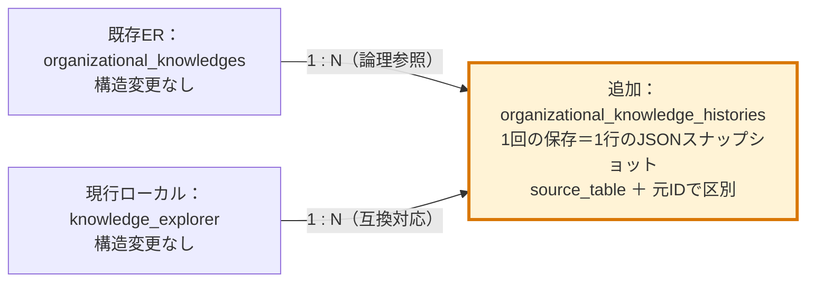

# 組織知のスナップショット履歴

実装日：2026-11-06。変更側は **OK-Coreのみ**。Forest-platformのコード・DBへの変更はない。

## 保存方針

現在値を保持する元テーブルと、追記型のバックアップを分ける。`organizational_knowledge_histories`を追加し、元テーブルのカラム・主キー・現在値の扱いは変更しない。履歴を一覧や検索の正本にはしない。

確認したローカルDBでは、現行画面の保存先は`knowledge_explorer`であり、ER図上の`organizational_knowledges`と関連3表はまだ存在しなかった。この実装は両方の保存元に対応するが、現行画面の登録先を正規化テーブルへ切り替える移行は行わない。AWSの構造は今回接続して確認していない。

| 操作 | 自動保存するイベント |
| --- | --- |
| 組織知・ツリー項目の登録 | `created`（本体とKFリンクの登録後） |
| 内容・根拠KFの更新 | `updated`のみ（更新後1件） |
| 名称変更 | `before_rename`、`renamed` |
| 論理削除 | `before_delete`、`deleted` |
| ルートの並べ替え | 変更された各項目に`before_reorder`、`reordered` |
| 右クリック →「履歴を保存」 | `manual` |

名称変更・削除・並べ替えの前後は同じ`operation_id`で対応づける。内容更新時は`before_update`を保存せず、更新後の`updated`だけを1件追記する。履歴の蓄積を開始する前の状態は、必要に応じて初回コピーSQLで保存する。既存の`before_update`行は自動削除しない。保存要求ごとに追記し、同じ内容の手動保存も省略しない。既存データの一括コピーは自動実行しない。

### 日時の管理と既存履歴の移行

| カラム | 意味 |
| --- | --- |
| `created_at` | 保存した版の組織知本体の`created_at`。初回コピーではexplorerの作成日時を引き継ぐ |
| `updated_at` | 保存した版の組織知本体の`updated_at`。更新後の履歴には更新後の値を引き継ぐ |
| `saved_at` | OK-Coreにスナップショットを保存・コピーした日時。元の日時と区別して保持 |

どのカラムも履歴行のUPDATEに追従する`ON UPDATE CURRENT_TIMESTAMP`は設定しない。作成・更新日時が元データや過去のJSONにない場合はNULLとし、現在時刻で補わない。

作成済みの履歴表には、先に[`../sql/2026-11-06_add_organizational_history_source_timestamps.sql`](../sql/2026-11-06_add_organizational_history_source_timestamps.sql)を利用者が適用する。**OK-Coreの履歴表へカラム追加2件（created_at / updated_at）、前版未適用の場合はsaved_by_user_idのNULL許可へのカラム変更1件**を行う。`knowledge_explorer`とForest側の構造は変更しない。

同じSQLで、既存履歴の未設定の日時を**その履歴自身のsnapshot_json内のknowledge.created_at / updated_at**から補完する。現在のexplorerと結合して過去の更新日時を上書きしない。既に設定済みの日時、saved_at、JSON本体、ハッシュ、履歴の件数は変更しない。このSQLを適用するまでは、新しい保存処理は503を返し、本体の変更も確定しない。

### 現在の組織知を初回コピーするSQL

[`../sql/2026-11-06_copy_knowledge_explorer_to_histories.sql`](../sql/2026-11-06_copy_knowledge_explorer_to_histories.sql)を追加した。履歴表の日時カラムを適用した後、phpMyAdminで対象のOK-Core DBを選び、ファイル全体を一度に実行する。保存者IDの手動指定は不要で、各行の`knowledge_explorer.updated_by`を`histories.saved_by_user_id`へそのまま引き継ぐ。今回、コピーSQLは実DBへ実行していない。

**コピーSQL自体はデータ追加のみ。構造変更は上記の日時カラム適用SQLで先に行う。** 元の組織知・KF紐付け・既存履歴の値は変更しない。コピー中は編集を止め、並行して同じSQLを実行しない。

- 全グループのルート・子項目・論理削除済みの行を含め、本体16カラムとKF紐付け6カラムを保存する。
- 所属グループが未設定・非正値の行は、履歴側のグループIDを`0`として退避する。元の値は`knowledge.knowledge_group_id`にそのまま残す。これは通常の所属先や閲覧許可を与える処理ではない。
- イベントは`baseline`。各元IDの初回コピーだけを作成し、再実行時は同じ元IDの`baseline`がある行をスキップする。通常の`manual`等の履歴が既にあっても、初回コピーは作成できる。
- 全件を同じ`operation_id`で識別し、保存日時は日本時間に揃える。`snapshot_sha256`は保存するJSONそのものから計算する。
- 履歴の`created_at`・`updated_at`は、それぞれexplorerの同名カラムから引き継ぐ。既に初回コピー済みの履歴の日時は、コピー再実行ではなく日時カラム適用SQLで補完する。
- `saved_by_user_id`は元の`updated_by`と一致させる。NULLもそのまま保存し、利用者の有効状態・存在による除外や別IDへの置換は行わない。通常の画面操作で自動保存する履歴は、従来どおり操作したログイン利用者を記録する。
- 最後の結果の`inserted_rows`が追加件数、`remaining_rows=0`が全元レコードに初回コピーがあることを示す。再実行で現在の内容に置き換わることはない。

このSQLはMariaDB 10.6 / MySQL 5.7.22以降向け。KFリンクの配列順は保証せず、保存した`display_order`と`id`で順序を判断する。別環境でカラムが増減している場合は、実行前にSQLの列一覧と照合する。

検証ではローカルMySQL 5.7.24に対してSELECTだけを実行し、全16カラム・KFリンク・ハッシュ・updated_by・元のcreated_at/updated_atの引き継ぎと、既存JSONの日時変換を確認した。コピーINSERTと既存履歴の日時補完は隔離したSQLiteで検証した。実DBのALTER/INSERT/UPDATE、AWSでの実行・MariaDB上の実行は未実施。

本体の変更と履歴追加は同じトランザクションで確定する。履歴テーブル・日時カラムが未適用なら503と適用SQL名を返し、元データを変更しない。履歴保存に失敗した場合も、本体・KFリンク・その操作の履歴をまとめてロールバックする。

## DB変更と適用順序

**対象DB：OK-Core。初回導入はテーブル追加1件。作成済み履歴表への今回の変更は日時カラム追加2件と、saved_by_user_idがNOT NULLの場合だけNULL許可への変更。knowledge_explorerの構造変更は0件。**

1. 対象DBのバックアップを取得する。
2. phpMyAdminで対象のOK-Core DBを選択する。`information_schema`は選択しない。
3. [`../sql/2026-11-06_create_organizational_knowledge_histories.sql`](../sql/2026-11-06_create_organizational_knowledge_histories.sql)を利用者が実行する。SQLには環境ごとに異なる`USE`を固定していない。
4. 既に履歴表がある場合は`2026-11-06_add_organizational_history_source_timestamps.sql`を実行し、日時追加・過去JSONからの補完を行う。`CREATE TABLE IF NOT EXISTS`は既存表に列を追加しない。`SHOW COLUMNS FROM organizational_knowledge_histories`で構造を確認する。
5. 下記のコードを同じリリースとして配備する。**SQLを適用するまでは、この版の組織知保存は503になる。**
6. 必要ならコピーSQLを実行する。手動保存・通常の内容更新では、それぞれ履歴1件が追加され、created_at/updated_atがJSON内の元データと一致することを確認する。

アプリはCREATE/ALTERを実行しない。既存の削除・並べ替え処理にあった自動ALTERも、今回履歴対応した経路から除去した。InnoDBでの本体・履歴の原子的保存を前提とする。

履歴表には元データや利用者表への外部キーを付けない。組織知・利用者を削除しても、履歴がCASCADEで失われないようにする。履歴の更新・削除・自動復元処理は実装していない。

## 記録内容

| カラム | 内容 |
| --- | --- |
| `history_id` | 履歴の連番。表示順の基準にできる |
| `source_table` | `organizational_knowledges`または`knowledge_explorer` |
| `organizational_knowledge_id` | 保存元でのID。`knowledge_explorer`の場合は`knowledge_node_id` |
| `knowledge_group_id` | 保存時に権限確認したグループ |
| `event_type` / `operation_id` | 操作の種類と、一操作の前後を結ぶ識別子 |
| `snapshot_version` | JSON構造の版（現在1） |
| `snapshot_json` | 以下のスナップショット全体 |
| `snapshot_sha256` | 保存したJSONバイト列のSHA-256。内容照合用であり署名ではない |
| `saved_by_user_id` | 通常は保存操作をしたログイン利用者。初回コピー時は元のupdated_by（NULL可） |
| `created_at` / `updated_at` | 保存した版の組織知本体の作成・更新日時（NULL可） |
| `saved_at` | 日本時間のバックアップ保存日時（ミリ秒付き） |

`source_table`とIDの組で区別する。同じ数値IDが両テーブルにあっても混同しない。`snapshot_json`には次を保存する。

- `knowledge`：本体の全カラム。今後カラムが増えても`SELECT *`で保存する。
- `fragment_links`：対応するKF紐付け表の全カラム。旧構造でも`experience`と`discussion`の同一数値IDを区別する。
- `category`：正規化構造では対応カテゴリ行。旧構造ではnullで、本体のparent_node_idを保持する。
- `discussion_posts`：正規化構造では対応する組織知の議論投稿。現行のKF対象`discussion_history`は組織知との直接対応がないため混入させない。
- `schema_version` / `source_table`：JSON自体の版と保存元。

任意の関連表が存在しない場合はnull、存在して0件の場合は空配列を記録する。KFの本文・産出元システムの活動履歴・添付ファイル本体までは複製しない。本体とその関連情報の状態を記録するバックアップであり、DB全体のバックアップや完全なシステム復元を置き換えるものではない。

## 保存機能の窓口

`POST php/save_organizational_knowledge_history.php`（OK-Coreのログインセッション必須）

```text
group_id=1
source_table=knowledge_explorer
node_id=123
```

`source_table`を省略した場合も、現行の`knowledge_explorer`を対象とする。組織知の右クリックメニューは上記の形式で呼び出す。クライアントからスナップショット本文・保存者IDを受け取らず、DBから対象を読み取る。選択グループの有効な所属を確認し、対象行のグループも照合する。手動保存では論理削除済みの行も、所属グループが一致すれば保存できる。将来の正規化構造を対象にする場合だけ、`source_table=organizational_knowledges`と`organizational_knowledge_id`を明示する。

共通関数は`php/organizational_knowledge_history_store.php`の`ok_core_save_organizational_knowledge_history()`。**関数の呼び出し元がトランザクションを開始・確定する。** 正規化後の登録・更新処理を別途実装する場合も、この関数を本体・紐付けの書き込みと同じトランザクションから呼ぶ。今回存在しなかった`organizational_knowledges`への自動更新経路は新設していない。

phpMyAdminで元テーブルを直接編集した場合や、この関数を呼ばない別システムの書き込みは自動記録されない。DBトリガーは追加していない。

履歴確認用SQL（読み取りのみ）：

```sql
SELECT history_id, source_table, organizational_knowledge_id, event_type,
       operation_id, saved_by_user_id, saved_at
FROM organizational_knowledge_histories
WHERE source_table = 'knowledge_explorer' AND organizational_knowledge_id = 123
ORDER BY history_id DESC;

SELECT snapshot_json
FROM organizational_knowledge_histories
WHERE history_id = 456;
```

## 指定ER図との差分

比較元：`docs/OK-Core_KF_ER図(暫定).drawio`。元図の既存テーブルは変更せず、追加1表を下図と[`organizational-knowledge-histories-ER差分.drawio`](organizational-knowledge-histories-ER差分.drawio)で示す。履歴表への追補は`saved_by_user_id`のNULL許可と`created_at`・`updated_at`の追加2列で、差分図の赤字で明記した。矢印は論理的な1対多であり、DBの外部キーではない。



## 配備対象と検証

- 新規：`php/organizational_knowledge_history_store.php`、`organizational_history_endpoint_bootstrap.php`、`organizational_history_node_actions.php`、`organizational_history_node_action_endpoint.php`、`save_organizational_knowledge_history.php`。
- 変更：`php/knowledge_node_create.php`、`update_knowledge_node.php`、`mark_delete_knowledge_node.php`、`update_node_title.php`、`reorder_root_nodes.php`、`js/organizational-combination-tab.js`。
- SQL・本書・ER差分図・`tests/organizational_knowledge_histories_test.php`も追加。既存の`tests/mixed_kf_flow_test.php`は登録・更新ケースで履歴表も一時表に隔離するよう変更した。この既存テストは履歴表を含むSQL適用済み環境を前提とする。

隔離テストではSQLiteのメモリDBに実際のPHP処理を読み込み、登録、更新後1件のみの保存、元の日時の継承、before_updateの拒否、KFリンク、手動保存、名称変更、削除、並べ替え、元データ削除後の保持、権限・スキーマ未適用時の拒否、履歴保存失敗時のロールバックを確認する。アプリの接続設定・実DBは使用しない。

```bash
for case in store create update rename delete reorder initialize manual missing missing_dates rollback forbidden unauthenticated method; do
  php tests/organizational_knowledge_histories_test.php "$case" || exit 1
done
```

CLIのPDO SQLite拡張が必要。SQLiteテストはMySQL/MariaDB固有のロック・照合順序・DDLの検証とは分けて扱う。実DBは構造とスナップショット取得の読み取り確認のみ行い、履歴表の作成や履歴行の追加は利用者によるSQL適用後に確認する。
